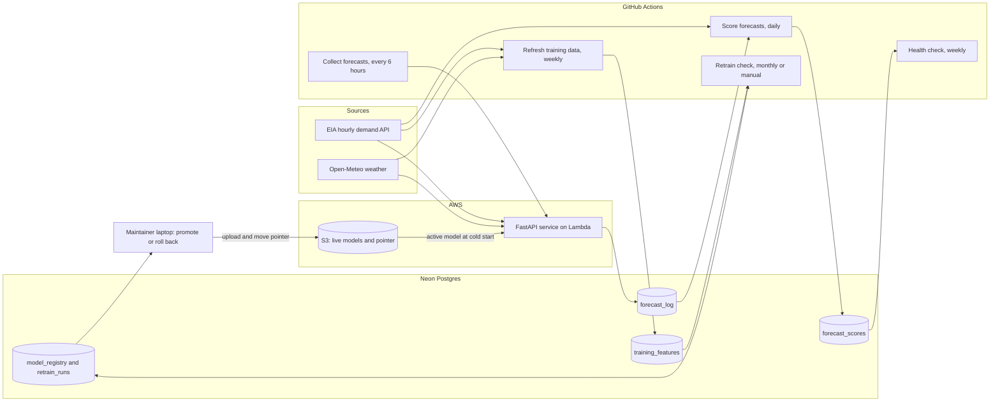

# Phoenix Grid Forecast

[](https://github.com/sameerahmed-cloud/phoenix-grid-forecast/actions/workflows/ci.yml)
[](https://github.com/sameerahmed-cloud/phoenix-grid-forecast/actions/workflows/collect-forecasts.yml)
[](https://github.com/sameerahmed-cloud/phoenix-grid-forecast/actions/workflows/score-forecasts.yml)
[](https://github.com/sameerahmed-cloud/phoenix-grid-forecast/actions/workflows/health-check.yml)

An end-to-end machine learning system that forecasts **hourly electricity demand for two Arizona utilities (AZPS and SRP)**, grades its own forecasts against what actually happened, watches for trouble, and can propose a better model when the old one goes stale, with a human approving every change.

It is a portfolio project built to show the part of machine learning that comes after the notebook: leakage-safe features, honest evaluation, a deployed API, scheduled pipelines, monitoring, and a safe model-update loop.

> **Status.** The pipeline has been running since mid-October 2026. Live accuracy numbers are still accumulating and are reported separately from the backtest (see [Live results](#live-results)). The hosted demo was a temporary deployment on a free AWS account; see [Deployment](#deployment).

## What it does

Every request fetches fresh hourly demand from the U.S. Energy Information Administration (EIA) and a weather forecast from Open-Meteo, cleans the demand with the same rules used for training, finds the newest *trustworthy* hour, builds the model's inputs, and returns a forecast for the next 24 hours. Every forecast is saved with a timestamp, so it can be graded later, once the real demand is published.

```text
GET /forecast?utility=AZPS      ->  24 hourly forecasts, made at <time>, starting after the newest usable hour
GET /model-info                 ->  which model is live, where it came from (S3 or the image), and when it was trained
GET /health                     ->  liveness
```

## Results (backtest)

Evaluation uses an **expanding window**: 16 three-month blocks from January 2023, each predicted by a model trained only on data before the block. Hyperparameters were fixed up front and never tuned against the test blocks. Scores are mean absolute percentage error (MAPE, lower is better), on 32,545 AZPS hours and 32,146 SRP hours. Peak means June to September, 4 to 8 PM Phoenix time, defined by the clock and not by outcome.

| | Copy yesterday | Utility's own forecast | LightGBM (served model) |
|---|---|---|---|
| AZPS, all hours | 5.57 | 6.59 | **4.70** |
| AZPS, summer peak | 5.79 | **4.10** | 4.85 |
| SRP, all hours | 6.05 | 4.95 | **4.73** |
| SRP, summer peak | 6.96 | **5.11** | 5.43 |

Copying the same hour from last week is the worst method everywhere, at about 10%.

**What this does and does not say.** The model beats the simple baseline everywhere and beats the utilities' own forecasts on average, but **the utilities are better at the summer-evening peak**. For SRP the utility is the best method in normal times, and the model wins only after SRP's data became erratic. There is no claim that the model beats the utility for SRP under normal conditions.

### SRP changed in April 2026

SRP's reported demand changed character from about April 2026: it fell relative to AZPS, and day-to-day swings reached a median of 13.9% in May. The cause is unexplained. Every method got worse, which points to the data and not to a stale model.

| | Copy yesterday | Utility | LightGBM |
|---|---|---|---|
| AZPS before April 2026 | 5.28 | 6.29 | **4.49** |
| AZPS after | 7.49 | 8.55 | **6.10** |
| SRP before | 4.96 | **3.36** | 3.80 |
| SRP after | 13.09 | 15.25 | **10.70** |

A drift report (Evidently, comparing April to June 2025 with April to June 2026) shows the weather inputs drifting for both utilities while only SRP's error tripled, which supports reading this as a data change and not a weather effect.

### Would retraining have helped?

A controlled experiment trained a "champion" on data before April 2026 and a "challenger" on data before June 2026, then scored both on June to August, which neither had seen. Two extra months of data made **no meaningful difference** (AZPS 6.12% vs 6.04%, SRP 7.48% vs 7.52%). The promotion gate correctly kept the existing models.

## Live results

Live scoring began on 16 October 2026. A forecast hour is graded once it is at least 48 hours old, because EIA revises recent values.

<!-- UPDATE MANUALLY: paste the output of `python -m src.models.run_live_scoring` and the latest health check summary here,
     with the date and the number of graded hours. Until there are at least about 72 graded hours per utility, say so. -->

| As of | Utility | Graded hours | Model MAPE | Copy-yesterday MAPE |
|---|---|---|---|---|
| (to be filled in) | | | | |

Expect live error to be somewhat **higher than the backtest**: the backtest uses the weather that actually happened, while live forecasts use a weather *forecast*.

## Architecture



The key safety property: **GitHub can only propose.** The scheduled jobs can read and write Neon, but they have no access to S3 or Lambda. Only the promote command, run from the maintainer's laptop with their own AWS login, can make a model live.

## How it works

1. **Data.** Hourly demand (actual and the utility's own forecast) from EIA, hourly weather from Open-Meteo, 2022 to present. Raw files are never edited; cleaning writes a separate file with an audit trail.
2. **Cleaning.** Each hour is compared with a centered 25-hour rolling median. Missing, non-positive, spiking and collapsing hours are flagged, plus the hour on either side of a flagged one. Runs of up to 3 bad hours are repaired by interpolation; longer gaps stay blank. The same function cleans training data and live data.
3. **Features.** 17 inputs per hour: demand lags (24, 48 and 168 hours back) and rolling averages, five weather variables plus cooling degree hours and a 3-day temperature average, and calendar features computed in Phoenix time. Every demand-based input is at least 24 hours old, so nothing the model sees would be unknown at forecast time. Unit tests enforce this.
4. **Model.** One LightGBM regressor per utility with fixed settings, predicting demand in megawatts.
5. **Serving.** FastAPI. The forecast window is the 24 hours after the newest usable hour, which lags real time by one to a few hours, so the effective horizon is roughly 20 to 22 hours. It is a rolling forecast and not a day-ahead one.
6. **Input validation.** Before predicting, the API checks the delivery as a whole: enough rows, no duplicate hours, a plausible demand level, physically sensible weather, and a newest hour that is not stale (warn after 6 hours, refuse after 12). A failed check returns a clear 503 and logs nothing.
7. **Logging and scoring.** Every forecast is saved with its time. Each day, hours that are at least 48 hours old are graded against EIA actuals and against *copy yesterday*, by lead time (how far ahead the forecast was made).
8. **Monitoring.** A weekly health check judges the last week of graded hours. It turns red only if the model is losing to copy-yesterday or if scoring has stalled; other signals (bias, a slide in accuracy) go in the report.
9. **Drift analysis.** An Evidently report compares two same-season windows a year apart, so seasons are not mistaken for drift.
10. **Retraining, semi-automatic.** See below.

## The model-update loop

| Step | Where it runs | What it does |
|---|---|---|
| Refresh training data | GitHub, weekly | Refetches recent EIA and weather, rebuilds features with the same code as training, validates, and upserts into Neon |
| Retrain check | GitHub, monthly or by button | Trains a challenger on everything before the newest 28 days; scores champion, challenger and copy-yesterday on those 28 days |
| Gate | same job | Promote only if the challenger is at least 5% better, has at least 500 holdout hours, beats copy-yesterday, and there are at least 14 days of data the champion never saw. Otherwise skip or keep. |
| Candidate | Neon registry | A winner is stored as a candidate and a GitHub issue is opened; nothing goes live |
| Promote | maintainer's laptop | Shows the holdout numbers, requires typing the version to confirm, copies the model to S3, moves the live pointer, and updates the registry |
| Roll back | maintainer's laptop | One command restores a previous version |

The API loads the active models from a private S3 bucket at startup, verifying each file against a recorded checksum. If S3 is unreachable or anything looks wrong, it falls back to the copy baked into the image and logs why, so a bad upload cannot take the service down.

The whole loop was **rehearsed end to end** on a throwaway database branch and a separate bucket, using a deliberately weak champion: a real comparison produced a candidate, the promote command made it live, and the rollback restored the original. The helper that wipes the registry refuses to run unless it can prove it is not pointed at the live system.

## Key design decisions

| Decision | Why |
|---|---|
| Demand lags of at least 24 hours | A one-hour lag would flatter the backtest and be unavailable for most of a live 24-hour window |
| UTC everywhere internally, Phoenix time only for calendar features | EIA's hourly timestamps are UTC; Phoenix has no daylight saving |
| Same cleaning code for training and serving | Avoids training/serving skew |
| Find the newest *usable* hour, not the newest published one | EIA's newest hour is often partial. A 1,310 MW partial reading once blanked two lags and produced a prediction cliff. A test now covers it. |
| Fixed hyperparameters | Tuning against the test blocks would leak the answer |
| Never remove hours because the utility's forecast disagreed | That would flatter the benchmark |
| Grade by lead time, only after 48 hours | Shows when the model can be trusted, and avoids EIA's revisions |
| GitHub proposes, a person promotes | A bug in automation can never change what is live |
| Fixed fallback model inside the image | A model-store failure degrades gracefully |

## Repository map

```text
src/
  ingest/          EIA and Open-Meteo downloads (retrying, paginated)
  processing/      demand cleaning (clean_one)
  features/        training features, live feature builder, input validation
  models/          baselines, expanding-window backtest, final training, live scoring, fixed settings
  api/             FastAPI app, forecast log store, S3 model store with fallback
  monitoring/      weekly health check, Evidently drift report
  retraining/      training table in Neon, refresh job, registry, retrain job, promote/rollback, publish tool, rehearsal
tests/             190+ tests (no test touches a real database or the network)
.github/workflows/ CI, collection, scoring, health check, data refresh, retrain check
Dockerfile, Dockerfile.lambda, docker-compose.yml
models/            the baked-in fallback models
```

## Run it yourself

Requires Python 3.10. Commands are for Windows PowerShell.

```powershell
python -m venv .venv
.\.venv\Scripts\Activate.ps1
pip install -r requirements.txt
```

Create a `.env` file (see `.env.example`):

| Variable | Needed for |
|---|---|
| `EIA_API_KEY` | live data and the refresh job (free key from EIA) |
| `DATABASE_URL` | the forecast log, scoring and retraining (a Postgres URL, for example Neon). If unset, the API logs to a local CSV. |
| `MODEL_BUCKET` | optional: load the active models from S3 instead of the baked-in copy |
| `LOG_PATH` | optional: CSV fallback location |

```powershell
python -m pytest -q                       # tests
ruff check src tests                      # lint
uvicorn src.api.main:app --reload         # API at http://127.0.0.1:8000/docs
docker compose up --build                 # the same API in a container
```

Rebuild the data and models from scratch (each module documents its options):

```powershell
python -m src.ingest.eia
python -m src.ingest.weather
python -m src.processing.clean_demand
python -m src.features.build
python -m src.models.train_lgbm           # the backtest, logged to MLflow
python -m src.models.train_final          # the models served by the API
```

Operate the loop (needs `DATABASE_URL`, `MODEL_BUCKET` and `aws login`):

```powershell
python -m src.retraining.registry status
python -m src.retraining.retrain --dry-run
python -m src.retraining.promote --utility SRP --version v2
python -m src.retraining.promote --utility SRP --rollback-to v1
```

## Automation

| Workflow | Schedule (UTC) | Purpose |
|---|---|---|
| CI | every push | ruff, tests, Docker build |
| Collect forecasts | 00:05, 06:05, 12:05, 18:05 | calls the API for both utilities so forecasts accumulate |
| Score forecasts | daily 08:20 | grades matured forecasts and saves the scores |
| Health check | Mondays 15:30 | weekly report card; red only if the model loses to copy-yesterday or scoring stalls |
| Refresh training data | Sundays 10:00 | keeps the training table current |
| Retrain check | 1st of the month 09:00, or manual | the champion-versus-challenger comparison |

GitHub may delay scheduled runs. Every forecast records its own timestamp, and scoring grades everything that is old enough, so delays cost nothing.

## Deployment

The API ran as a container image on **AWS Lambda** (image in ECR, public Function URL, 1 GB memory, 2-minute timeout, concurrency capped at 3), behind the Lambda Web Adapter. Models are served from a private S3 bucket through a read-only IAM permission scoped to that bucket. Forecasts are logged to Neon Postgres.

A few honest notes:

- The account is on AWS's Free plan, and its organization-level guardrails blocked creating password-based IAM users. Everything is done with a short-lived federated login instead, so no long-lived access keys exist anywhere.
- The free data sources are sometimes slow. Cold requests normally take 5 to 40 seconds, and one EIA call was observed taking about 97 seconds, which is why the timeout is 2 minutes and the collector retries with a delay.
- **The hosted demo is temporary.** The Free plan closes at six months. The repository is designed to be reproduced locally with Docker, and the same image deploys to any container host.

Least-privilege permission attached to the function's role (bucket name is a placeholder):

```json
{"Version": "2012-10-17",
 "Statement": [{"Effect": "Allow", "Action": "s3:GetObject", "Resource": "arn:aws:s3:::<your-model-bucket>/*"}]}
```

## Limitations

- **Weather.** The backtest uses actual weather; live forecasts use forecast weather. Live error will be higher. One weather point stands in for all of Phoenix.
- **Horizon.** The effective horizon is roughly 20 to 22 hours, not a formal day-ahead forecast.
- **SRP.** Its reported demand changed in April 2026 for reasons I could not explain. Results are reported before and after.
- **Peak hours.** The utilities' own forecasts are better than the model at the summer evening peak.
- **Data.** About four and a half years of history; two utilities.
- **Live evidence is young.** The live results above are still accumulating, and the first fair retraining comparison needs about four more weeks of data than the current champion has seen.
- **Models are pickle files.** They are loaded only from a private bucket I control, and every file is checksum-verified, but that trust boundary is the reason the bucket must stay private.
- **Semi-automatic by design.** A person approves every promotion.
- **Python 3.10** reaches end of life in October 2026; upgrading is straightforward but has not been done.

<!-- UNCOMMENT after adding the images to docs/images/

## Screenshots

| | |
|---|---|
|  Scheduled workflows |  Backtest and experiment runs in MLflow |
|  /model-info reading from S3 |  Weekly health report |
|  SRP drift report |  Promote and rollback rehearsal |

-->

## Data sources

Demand data from the U.S. Energy Information Administration (EIA) Open Data API. Weather data by [Open-Meteo.com](https://open-meteo.com/), licensed CC BY 4.0.

## License

MIT. See `LICENSE`.